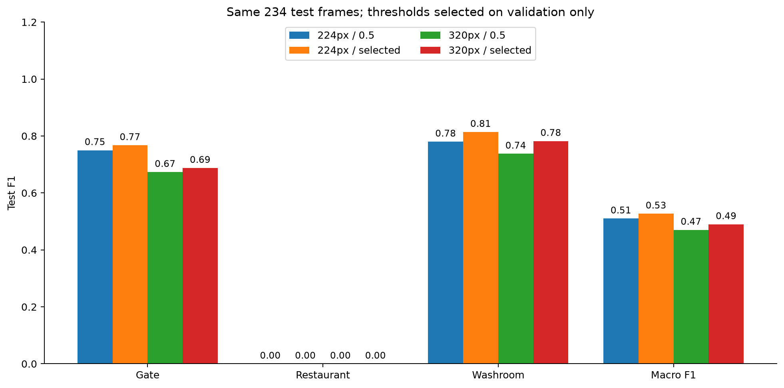

# Higher resolution and validation-selected thresholds

Historical backup. The current presentation focuses on the [clean-image 224px checkpoint](../clean_224/results.md);
its dataset/split differs, so this report is not a direct score comparison with that model.

Presentation: [ten claim-and-evidence slides](../progress_slides.md), with local
SVGs under `reports/svg/` and matching PNGs under `reports/png/`. Regenerate with
`.venv/bin/python scripts/build_progress_figures.py` from the repository root.
Original baseline results and scripts are preserved separately.

Two checkpoints, four evaluation cases. The 224px checkpoint is the original
baseline (epoch 9); it was not retrained. The 320px model was
trained for ten epochs and selected epoch 10 by validation
macro F1 at fixed 0.5 thresholds. Historical baseline reports remain unchanged.

**Outcome:** Increasing resolution did not improve fixed-threshold test macro F1 in this run (0.510 at 224px versus 0.470 at 320px). Validation-selected thresholds give 0.527 and 0.490, respectively. This is a single-seed outcome, not evidence that higher resolution can never help.

| Input / threshold | Gate F1 | Restaurant F1 | Washroom F1 | Macro F1 | Exact match |
| --- | ---: | ---: | ---: | ---: | ---: |
| 224px / 0.5 | 0.750 | 0.000 | 0.780 | 0.510 | 73.9% |
| 224px / selected | 0.767 | 0.000 | 0.814 | 0.527 | 74.8% |
| 320px / 0.5 | 0.673 | 0.000 | 0.738 | 0.470 | 68.4% |
| 320px / selected | 0.688 | 0.000 | 0.782 | 0.490 | 60.3% |



## Validation-only threshold selection

| Input | Gate threshold | Restaurant threshold | Washroom threshold |
| --- | ---: | ---: | ---: |
| 224px | 0.557020 | 0.833220 | 0.209320 |
| 320px | 0.690878 | 0.978830 | 0.007333 |

Restaurant test F1 is 0.000
at 224px and 0.000
at 320px with selected thresholds. Resolution and threshold changes have not
resolved restaurant recognition on these held-out videos.

Each threshold maximizes its class's F1 over the unique validation scores of the
selected checkpoint. Equal maxima prefer the threshold nearest 0.5, then the larger
threshold. The rule is `score >= threshold`. Checkpoint selection happens first at
fixed 0.5; thresholds are then selected using validation predictions only, before
test inference. Thresholds are not learned from test labels or changed after test
inspection. The validation F1 after threshold fitting is an optimization result,
not an independent performance estimate.

Validation and test predictions include frame identity, all three labels, and all
three sigmoid scores. See the CSVs in [224px results](v3_224_thresholds/) and
[320px results](v3_320/). The prediction command reads selected thresholds and input
size directly from each new checkpoint. Scores from weighted BCE are not calibrated
probabilities; a selected threshold need not be near 0.5.

## Per-class precision and recall

| Input / threshold / class | Precision | Recall | F1 |
| --- | ---: | ---: | ---: |
| 224px / 0.5 / gate | 0.805 | 0.702 | 0.750 |
| 224px / 0.5 / restaurant | 0.000 | 0.000 | 0.000 |
| 224px / 0.5 / washroom | 0.969 | 0.653 | 0.780 |
| 224px / selected / gate | 0.846 | 0.702 | 0.767 |
| 224px / selected / restaurant | 0.000 | 0.000 | 0.000 |
| 224px / selected / washroom | 0.909 | 0.737 | 0.814 |
| 320px / 0.5 / gate | 0.630 | 0.723 | 0.673 |
| 320px / 0.5 / restaurant | 0.000 | 0.000 | 0.000 |
| 320px / 0.5 / washroom | 0.908 | 0.621 | 0.738 |
| 320px / selected / gate | 0.673 | 0.702 | 0.688 |
| 320px / selected / restaurant | 0.000 | 0.000 | 0.000 |
| 320px / selected / washroom | 0.677 | 0.926 | 0.782 |

## Controlled settings

Architecture: pretrained MobileNetV3-Small with three binary heads. Same pinned
Hugging Face revision, seed 42, batch 32, AdamW, weight decay 0.0001, no augmentation,
ImageNet normalization, and training-only positive class weights. Three frozen
epochs at head LR 0.001, seven all-layer epochs at LR 0.0001. The new training run
changes image resolution only; both threshold policies are evaluated from the same
checkpoint per resolution.

320px inputs were generated directly from original unmarked PNGs using the same
bilinear aspect-ratio-preserving padding, rather than enlarging the 224px files.
Frame identities, labels, boxes, exclusions and video splits were checked for exact
agreement: 1,209 train / 249 validation / 234 test, grouped into 13/3/3 videos.
The 208 marked-only frames remain excluded, removing all triple-positive examples
and 54.5% of original restaurant-positive frames. This experiment does not fix that
selection bias. Only three correlated test videos and one seed are evaluated.

Experiment YAMLs are tracked under `experiments/`; the original run's YAML is a
historical transcription of its saved config.json, not a claim it originally ran
from YAML. New Modal calls read their YAML settings and save a copy beside outputs.
Runtime normalization, class weights, versions and selected thresholds are saved in
config.json; thresholds.json describes the selection rule. Large image/annotation
manifests and weights stay under gitignored data/ and artifacts/.

## Latency

| Input | T4 mean | Server CPU mean (1 thread) |
| --- | ---: | ---: |
| 224px | 4.46 ms | 6.93 ms |
| 320px | 4.48 ms | 9.44 ms |

The 224px timings are reused from the original run; threshold-only evaluation did
not benchmark a new model. The 320px timings were measured in the new T4 run.
Both use warm batch-one forward pass plus sigmoid, 20 warmups and 100 repeats.
CPU host hardware may differ. Image decode, preprocessing, camera, speech, network,
cold start and threshold application are excluded. iOS latency remains unmeasured.

These comparisons establish descriptive resolution and threshold effects on the
existing test set, which has already been inspected. Continue tuning on validation
data and reserve new independent capture sessions for a final assessment.

## Reproduce

```sh
.venv/bin/python -m baseline.data --size 320 --output data/v3_320
.venv/bin/modal run modal_train.py --config experiments/v3_224_thresholds/config.yaml
.venv/bin/modal run modal_train.py --config experiments/v3_320/config.yaml
.venv/bin/python -m baseline.compare_resolution
.venv/bin/python -m baseline.predict path/to/image.png --checkpoint artifacts/v3_320/best.pt
```

Existing run directories are protected against overwrite. Actual Modal usage is
recorded in modal_usage.json after the runs; the overall authorized budget is $10.
No additional training or parameter search is started automatically.
